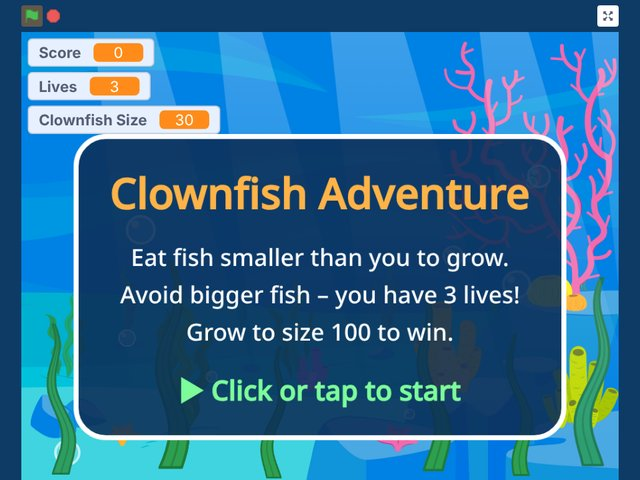
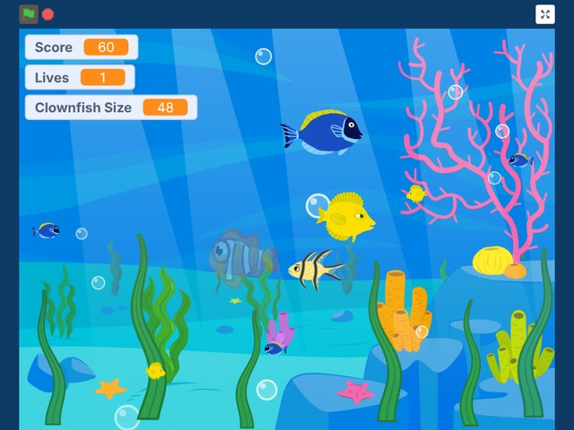

# Clownfish Adventure

A fun ocean game made in Scratch: guide the clownfish, eat smaller fish to grow, and avoid the bigger ones!

### [▶ Play it now in your browser](https://edisonli5656.github.io/Clownfish-Adventure/)
Works on computers, phones and tablets. Nothing to download.

  
  

## How to play
- Click or tap the screen to start.
- Move the mouse (or drag your finger on a phone) — the clownfish follows.
- Eat fish smaller than you to grow and score points.
- Bigger fish will eat you! You have 3 lives (you flash and are safe for a moment after losing one).
- The bigger you get, the more big fish appear. Reach size 100 to win!

## Install on your phone
Open the link above, then:
- **iPhone (Safari):** Share → Add to Home Screen
- **Android (Chrome):** Menu → Install app / Add to Home screen

## Files
- `index.html` – the game (runs in any browser)
- `clownfish-adventure.sb3` – the original Scratch project, open it at scratch.mit.edu
